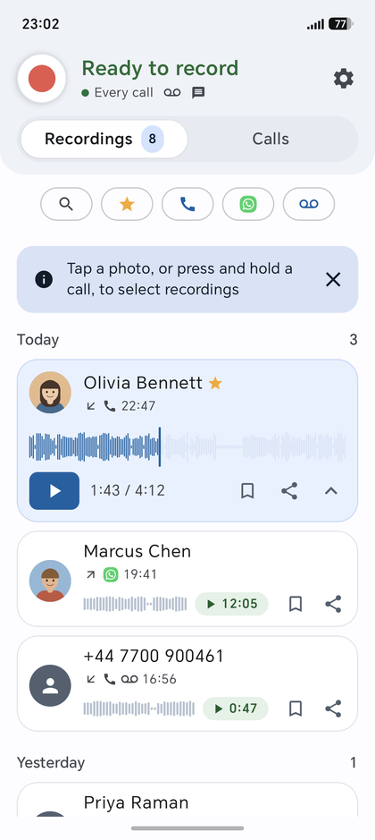
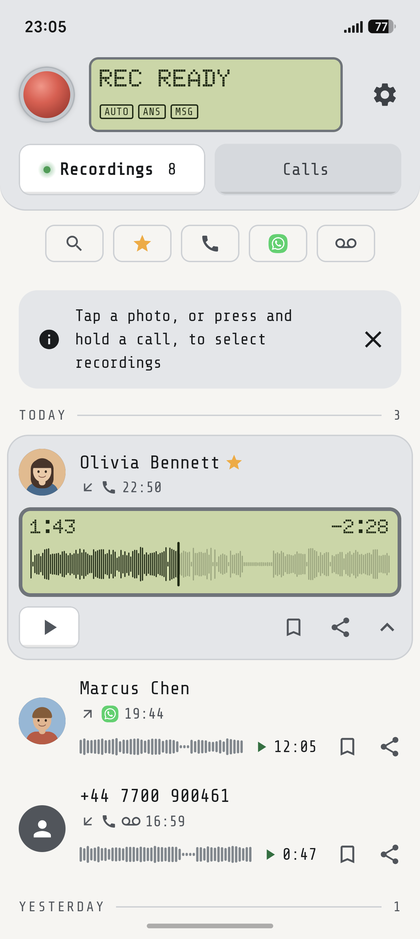
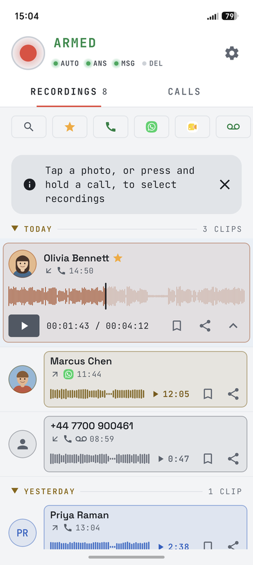
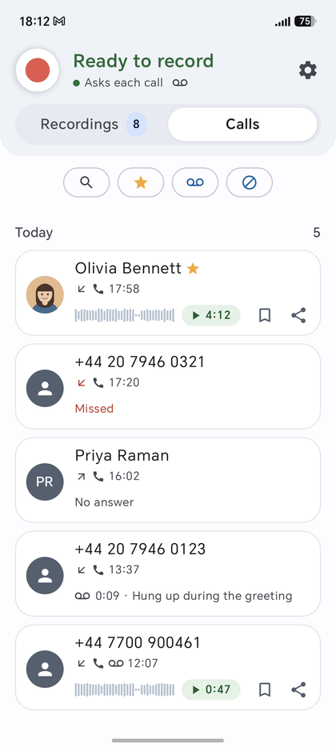
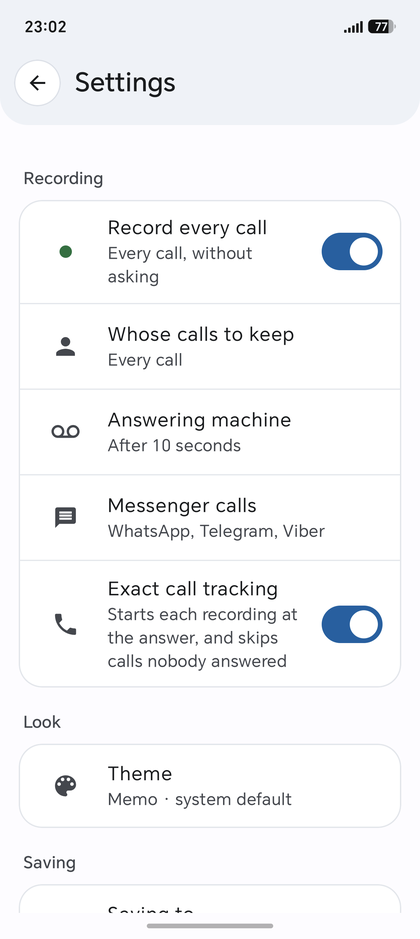
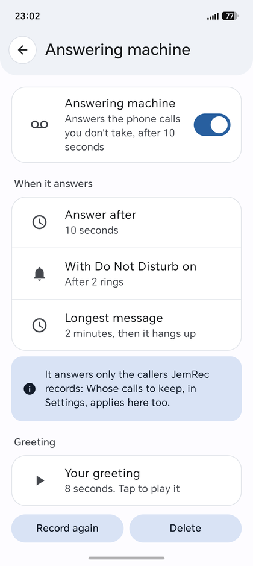
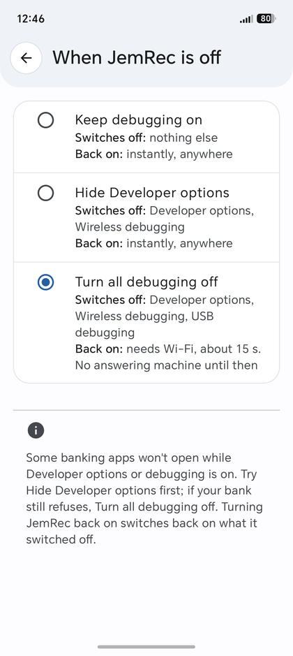
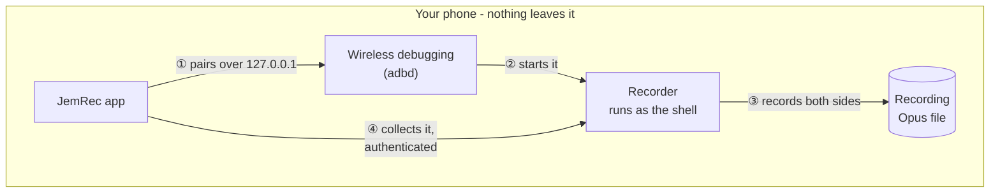

# JemRec

**A call recorder for unrooted Android — phone and messenger calls.**

Both sides of the call. No root, no computer, no second app — 
the phone sets itself up.

[**Website**](https://jemcik.github.io/JemRec/) · [Manual](https://jemcik.github.io/JemRec/setup.html) · [Releases](https://github.com/jemcik/JemRec/releases) · [Privacy policy](https://jemcik.github.io/JemRec/privacy-policy.html) · [Support](#support-jemrec)

[-3DDC84)](#phones-and-android-versions)

<picture><source media="(prefers-color-scheme: dark)" srcset="docs/screenshots/memo/home-dark.png"></picture>
<picture><source media="(prefers-color-scheme: dark)" srcset="docs/screenshots/deck/home-dark.png"></picture>
<picture><source media="(prefers-color-scheme: dark)" srcset="docs/screenshots/multitrack/home-dark.png"></picture>

Three looks - <b>Memo</b>, <b>Deck</b> and <b>Multitrack</b> - each light, dark or as the phone, in Settings → Theme.

<picture><source media="(prefers-color-scheme: dark)" srcset="docs/screenshots/memo/calls-dark.png"></picture>
<picture><source media="(prefers-color-scheme: dark)" srcset="docs/screenshots/memo/settings-dark.png"></picture>
<picture><source media="(prefers-color-scheme: dark)" srcset="docs/screenshots/memo/answering-dark.png"></picture>
<picture><source media="(prefers-color-scheme: dark)" srcset="docs/screenshots/memo/whenoff-dark.png"></picture>

The people in these screenshots do not exist: a screenshot of a call recorder is a screenshot of someone's calls, so the debug build invents them. Everything else is real.

## Why JemRec

- **Both sides of every call.** Phone calls, and WhatsApp, Telegram, Viber and
  Google Meet calls on Android 14 or newer.
- **No root, no computer, no second app.** The phone pairs with its own
  Wireless debugging and sets itself up, once, in a few minutes.
- **Nothing leaves your phone.** No account, no cloud, no analytics. The only
  network JemRec uses is the phone talking to itself.
- **It tells you when something is wrong.** A recording that came out silent,
  a recorder that is down, a call that went by unrecorded - each gets a
  notification, so you do not find out on the day you need the call.
- **Your rules.** Record every call or be asked first, keep only some people's
  calls, and let old or very short recordings clear themselves away.
- **Free, open and verifiable.** Apache-2.0, and F-Droid rebuilds every release
  from this source and checks it matches, byte for byte.

## Get started

1. **Install it** from [F-Droid](https://f-droid.org/packages/com.jemcik.jemrec/),
   or download the APK from [Releases](https://github.com/jemcik/JemRec/releases).
2. **Follow the setup.** JemRec walks you through it and watches for each step:
   one question (whether to hide Android's debugging notification), Developer
   options, USB and Wireless debugging (no cable needed), and pairing - the
   phone pairs with itself. Type the six-digit code into JemRec's
   *notification*, not the app: leaving Settings closes the code window. Once;
   the pairing survives restarts.
3. **Let it keep running:** on phones that stop apps in the background
   (Honor, Huawei, Xiaomi, Samsung and others), setup asks you to allow JemRec
   in the phone's own screen for it, and tells you what to tap there. If the
   phone stops JemRec anyway, or holds it back while it restarts the recorder,
   a notification says so. The same screen is in Settings → *Survive a
   restart*.

**Prefer to watch?** The whole setup, start to finish, in 2:22
[on YouTube](https://www.youtube.com/watch?v=rt25pZd8R9M), filmed on an Honor
Magic 8 Pro.

Then run **Settings → Diagnostics → Self-test**. It answers, in about a second,
whether your phone hands over both sides of a call.

The full manual, with what to do when a step misbehaves:
[on the web](https://jemcik.github.io/JemRec/setup.html) or
[in this repository](docs/SETUP.md).

<b>Trouble installing?</b> Play Protect, sideloading, and checking the APK

 

**F-Droid is the easy way:** install the F-Droid client, search for JemRec, and
updates arrive like any other app's. F-Droid is an installer the phone already
trusts once you have allowed it, so nothing below applies.

**The APK from Releases** asks whether to allow installing from your browser or
file manager; that is the sideload prompt. The two are the same file: F-Droid
builds each tag on their own machine, checks the result against the APK here
byte for byte, and publishes **this** project's signed APK rather than one of
their own - so whichever way you installed, the other can update it in place,
with no uninstall and no pairing again. Verified on 0.8: what F-Droid serves is
byte-identical to `jemrec-0.8.apk` on the releases page, down to the signature.

**Play Protect may get in the way, and what it takes differs by phone.** It
warns about apps it has not seen before, which is every app that is not on
Play, so this is not a judgement about JemRec. Three phones, three outcomes:

| Phone | What happened |
| --- | --- |
| Honor Magic 8 Pro | Installed with no complaint. |
| Galaxy S20 | Refused. Turning Play Protect off long enough to install, then back on, worked. It is in the Play Store under your profile picture → Play Protect → Settings. |
| LineageOS | Refused from the browser. Opening the same file from the **Files** app installed it. Each app that can install needs *Install unknown apps* granted to it separately, and not every one of them is allowed to. |

**To check what you downloaded** rather than trust it: every release is signed
with the same certificate, and the release workflow prints its digest on each
run:

    apksigner verify --print-certs jemrec-0.8.apk
    SHA-256: 50aeab3630f0198ea3845db51413b1ad29582f78240fa2df6fe55ba8537afdf8

<b>Why "start by itself" matters</b> after a restart

 

A reboot kills the recorder, and building it again takes a few seconds of
Wi-Fi. With auto-start allowed (on an Honor: Settings → Battery → App launch →
JemRec → *Manage manually*, with *Auto-launch* on), the recorder was back
**ten seconds** after Wi-Fi came on, with the app never opened. Without it,
the phone declined to start the app at boot and nothing came back by itself -
**opening JemRec once** had it recording sixteen seconds later. That is the
fallback, and it always works.

Wi-Fi is needed to *rebuild* the recorder, never to use it. Once it is up,
recording carries on with Wi-Fi off, on mobile data, anywhere. The measurements
are in [How JemRec works](docs/ARCHITECTURE.md#after-a-restart).

> [!IMPORTANT]
> **Recording calls is your responsibility.** Consent law differs by country and
> sometimes by state: one party, all parties, or a spoken notice. JemRec records
> what you tell it to and warns nobody on your behalf.

## What you can do

| | |
| --- | --- |
| **Record every call, or be asked** | Automatic mode records every call; ask-first records nothing until you tap Record. A Quick Settings tile turns recording on and off. → [more](docs/ARCHITECTURE.md#recording-and-being-asked) |
| **Start at the answer** | Exact call tracking cuts the ringing, skips calls nobody answered, and splits call waiting into one recording per call. → [more](docs/ARCHITECTURE.md#exact-call-tracking) |
| **Keep only the calls you want** | All your contacts, all but some, only some, or none - and other numbers on their own switch. → [more](docs/ARCHITECTURE.md#whose-calls-to-keep) |
| **Messenger calls** | WhatsApp, Telegram, Viber, and Google Meet calls and meetings, both sides, each switched on separately, with the caller's name from the app's notification. Android 14+. → [more](docs/ARCHITECTURE.md#messenger-calls) |
| **See every call** | The Calls tab is your call log, each call with its recording - or, if there is none, why. Search either list, or narrow it with a tap. → [more](docs/ARCHITECTURE.md#the-calls-tab) |
| **Name files your way** | By date and time, with the caller, or the way Honor's Phone app plays them from its call history. → [more](docs/ARCHITECTURE.md#file-names) |
| **Play, keep, clean up** | A call plays as its waveform, to see where people talk, and plays on with the screen off, under the phone's media controls; a keep mark, a 30-day Recently deleted, and auto-delete for old or very short ones. → [more](docs/ARCHITECTURE.md#playing-in-the-background) |
| **Hear about problems** | A notification after each call, and one when a recording is silent, the recorder is down, a call went unrecorded, or the phone stopped JemRec or held it back in the background. A call that came out wrong? *Copy a report* in Diagnostics says how it was recorded, for an issue on GitHub. → [more](docs/ARCHITECTURE.md#after-the-call-and-when-something-is-wrong) |
| **Answering machine** | Off until you switch it on. Answers a phone call you have not taken after 5 to 30 seconds - after two rings when Do Not Disturb would silence the caller - plays the greeting you recorded and keeps the message, by the same rules as recording. Take the call or hang up from its notification while they speak. It stands down for a day after you call an emergency number. A test call tells you whether it works on your phone. → [more](docs/ARCHITECTURE.md#the-answering-machine) |
| **Open your banking app** | Some banking apps won't open while Developer options or debugging is on. Turning JemRec off can hide Developer options too, or switch all debugging off; turning it on puts back what it switched off. Settings → When JemRec is off. → [more](docs/ARCHITECTURE.md#off-and-debugging-with-it) |
| **Three looks** | Memo, calm and simple; Deck, a pocket recorder with an LCD and a REC key; Multitrack, a sound editor with a colour for each caller. Each light, dark or as the phone, in Settings → Theme. → [more](docs/ARCHITECTURE.md#three-looks) |

Recordings are Opus files in the phone's standard `Recordings/JemRec` folder,
where any file manager or music app can open them - or in a folder you choose.

## How it works

Android's `voice-call` audio source carries both sides of a call, but only
system-level identities may read it - and the one an ADB session runs as, the
**shell**, is among them. Getting a shell normally takes a computer, root, or a
helper app like Shizuku. JemRec makes the phone its own computer:

1. **The app pairs with the phone's own Wireless debugging** - the same pairing
   a laptop does, with both ends on the same handset.
2. **For a few seconds, it uses that session to start a small recorder** that
   runs as the shell, then closes it. The recorder outlives the session.
3. **The recorder watches the calls and writes each one to a file** itself, so
   a phone that freezes background apps cannot cut a recording short.
4. **The app collects the finished file** over a socket on which the recorder
   and the app each prove who they are.

Wi-Fi is needed only to start the recorder - after a reboot, say - never to
record. **[The full design, and the measurements behind each decision →](docs/ARCHITECTURE.md)**

## Phones and Android versions

| | Phone calls | Messenger calls |
| --- | :---: | :---: |
| **Android 12 and 13** | ✓ | — Android does not allow it |
| **Android 14 and newer** | ✓ | ✓ WhatsApp, Telegram, Viber, Google Meet |

Google Meet was tested on the Honor: calls both ways and a meeting. Signal
takes the same path as the other messengers and has not been tested yet.
Developer options and Wireless debugging are on every Android phone, though the
menu they live in differs by make; JemRec names the right path for yours.

**Both sides of the call** have been recorded on four phones, across three very
different Android builds:

| Phone | Build |
| --- | --- |
| Honor Magic 8 Pro (BKQ-N49) | MagicOS 10 and 11, Android 16 and 17 — the phone it was developed on |
| Samsung Galaxy S20 | One UI |
| Samsung Galaxy S23 | One UI, Android 16 — over Wi-Fi Calling too, which it carries like a messenger call |
| OnePlus | LineageOS 23 |

Four is not a compatibility list. The one thing nobody can promise for a phone
they have not held is its audio hardware: some hand over both sides of the call,
some one, some silence. The **Self-test** answers it on yours in about a second:
it opens a real capture over the same path a call takes and tells you what came
out of it.

**The answering machine** has been tried on two phones: the Honor, on 2G calls
(its carrier would not register it for VoLTE), and a Galaxy S23 over Wi-Fi
Calling. Whether a phone carries a greeting to the caller is up to its audio
hardware too - Android's own answer was wrong on the
Honor - so the answering machine's settings hold its own checks and a test call.

## Privacy and permissions

- **No microphone permission.** The app never records; the recorder does the
  capturing - calls, and your answering-machine greeting.
- **Nothing leaves the phone**, and nothing is collected about you. *Copy a
  report* in Diagnostics puts how the last call was recorded on the clipboard,
  with no number, name or sound in it, only when you tap it.
- **Calls and contacts only if you allow them** - to name callers, keep calls
  by who they were with, and notice a call that went unrecorded. Everything
  works without them.
- **No caller on the lock screen.** While a recording plays, the phone's media
  controls name the caller only once it is unlocked; locked, they say *Call
  recording*.
- **Debugging stays on while JemRec is on**, because the recorder needs
  it; while it is off, it can go too (Settings → When JemRec is off). A computer you have paired with the phone can connect to it over the
  same Wi-Fi, and one you have authorised before over a cable; an unpaired one
  cannot. Now and then, check *Wireless debugging →
  Paired devices* and remove anything you do not recognise.
  → [What stays switched on](docs/ARCHITECTURE.md#what-stays-switched-on)

<b>Every permission, and why</b>

 

In the order F-Droid's listing page shows them, because a permission a call
recorder does not explain is one its user has to guess at:

| Permission | Why |
| --- | --- |
| `INTERNET` | Not about the internet: Android requires it for any TCP socket, including one to `127.0.0.1`. |
| `ACCESS_NETWORK_STATE` | To tell whether there is Wi-Fi to rebuild the recorder over, instead of trying and failing. |
| `WRITE_SECURE_SETTINGS` | Granted by the app to itself over its own ADB session. Nothing but a shell can grant it, so no user can be talked into it. It lets JemRec switch debugging back on when the phone turns it off, and off with JemRec when you ask it to. |
| `POST_NOTIFICATIONS` | The recording notice, the ask-first prompt, the pairing code box. |
| `FOREGROUND_SERVICE`, `FOREGROUND_SERVICE_SPECIAL_USE` | To stay alive while a call is being recorded and while the finished file is collected; while the recorder is restarted after a computer's cable comes out; and for the seconds it takes to warn that the phone stopped JemRec in the background. `SPECIAL_USE` is the honest type: the microphone type would need a microphone permission this app does not hold. |
| `FOREGROUND_SERVICE_MEDIA_PLAYBACK` | To play a recording on with the screen off, under the phone's media controls. It plays; it never records. |
| `RECEIVE_BOOT_COMPLETED` | A reboot kills the recorder; this is what arms the job that rebuilds it. |
| `READ_MEDIA_AUDIO` | To list recordings made before a reinstall. Refusing it only hides those. |
| `READ_EXTERNAL_STORAGE` | Android 12 only, which has no `READ_MEDIA_AUDIO`: the same, to list recordings made before a reinstall. It covers photos and videos too; JemRec reads only its own folder. Refusing it only hides those. |
| `READ_CALL_LOG`, `READ_CONTACTS` | Optional. The only way to know who a call was with: to label a recording, to name a file after the caller, to keep or leave out a call by who it was with, and, for the call log, to notice a call that went unrecorded. |
| `MANAGE_ONGOING_CALLS` | For exact call tracking. Not one an app can ask for: the daemon allows it, as the shell, while the switch is on. Android then tells JemRec when each call is answered and ends. Tracking never acts on a call; the answering machine's answering is the recorder's, as the shell. |
| `USE_FULL_SCREEN_INTENT` | Lets the ask-first prompt last a minute instead of five seconds. Not auto-granted, and nothing is gated on it. |
| `WAKE_LOCK` | So the keep-alive job can finish its few seconds of work, and so a phone with its screen off stays awake while it brings the recorder back after a USB cable, a minute and a half at most. WorkManager declares it too. |

What is left out, and why, is in
[How JemRec works](docs/ARCHITECTURE.md#what-it-does-not-ask-for).

## FAQ

<b>Does it really record both sides?</b>

 

Yes, where the phone's audio hardware hands both sides over - which it did on
every phone above. The Self-test tells you for yours in about a second. On
speakerphone, a messenger call's other person is heard on your side too: your
side is the plain microphone, without the call app's echo cancellation. A call
that still comes out with one side - over Wi-Fi Calling, say - is worth an
issue on GitHub: tap *Copy a report* in Diagnostics right after it and paste
that in.

<b>Does it record Google Meet?</b>

 

Yes, calls and meetings, both sides, on Android 14 or newer - once you switch
Google Meet on under *Messenger calls*. Like the messengers, it is off until
you do. Meet puts its calls through Android's own call service, and up to 0.21
JemRec took them for phone calls and recorded every one, meetings included.
Now a call is a phone call only when Android says the phone itself is in one.

<b>Will callers hear my greeting?</b>

 

On the two phones it has been tried on, yes. No app can play sound into a
call, so the recorder does it as the shell: on the Honor through an output
Android calls *in-call music*, on a Galaxy S23 over Wi-Fi Calling through
Android's call-screening route; not every phone has either. Before you switch the answering machine on,
its *Checks* tell you in a second whether yours does, and a *Test call*
settles it for that kind of call: 2G, VoLTE and Wi-Fi Calling differ. Your
microphone is muted while the greeting plays and the message is left, so the
caller hears your greeting and nothing of your room.

<b>Why does it need Wi-Fi?</b>

 

Only to *start* the recorder: that is the one step that needs Wireless
debugging, which Android runs over Wi-Fi. Once started, the recorder carries on
with Wi-Fi off, on mobile data, anywhere. A reboot stops it, and the next few
seconds of Wi-Fi bring it back by themselves (see
[Get started](#get-started), step 3). Unplugging the phone from a computer can
stop it too (a charger does not); on Wi-Fi it is back within seconds, by
itself. With the screen off, step 3 matters here as well: without it, an
Honor's battery manager kept the recorder down for about four minutes in two
tests of three, and 8.5 minutes in another. Until then nothing is recorded -
the header says so, a notification says the phone held JemRec back the moment
it lets JemRec run again, and one says the recorder is down if it stays down
two minutes. And if When JemRec is off is set to *Turn all debugging off*,
turning JemRec back on needs Wi-Fi too.

<b>Why isn't it on Google Play?</b>

 

Play removed call recorders in 2022 by forbidding the Accessibility API for
recording, and no policy change since has re-opened the door. That is a
distribution decision, not a technical one - the app itself never needed Play,
and F-Droid asks only that a build be free software and reproducible from its
source, which this one is. It never will be on Play.

<b>Is recording calls legal?</b>

 

It depends on where you and the other person are: some places need one party's
consent, some everyone's, some a spoken notice. That is your responsibility;
JemRec records what you tell it to and warns nobody on your behalf.

<b>Where are my recordings, and what happens to them if I uninstall?</b>

 

In the phone's standard `Recordings/JemRec` folder (or the folder you chose),
as Opus files any music app can play; Share can also convert one to `.m4a` for
iPhones and Macs. They are yours rather than the app's, so they stay when
JemRec is uninstalled - delete them first if you want them gone. Deleted ones
wait in Recently deleted for 30 days. Installed again, JemRec shows them as
they were, once you let it read them (it asks): each recording carries its own
marks - a message, kept, who a messenger call was with - inside the file.

<b>My banking app won't open while debugging is on</b>

 

Choose in Settings → **When JemRec is off** what goes off with JemRec, then
turn JemRec off - with the record button or the Quick Settings tile - before
you open the bank:

- **Hide Developer options**: Developer options and Wireless debugging go off.
  USB debugging stays on, so JemRec keeps its recorder and turns back on
  instantly, anywhere.
- **Turn all debugging off**: USB debugging goes off too, and the recorder with
  it. Turning JemRec back on then needs Wi-Fi and takes about 15 seconds, and
  the answering machine is off until then. Away from Wi-Fi, JemRec asks first.

Try the first; if your bank still refuses, the second. Turning JemRec back on
puts back what it switched off. Measured on an Honor (Android 17): with
Developer options and Wireless debugging off, the recorder ran on through Wi-Fi
off and on, a locked screen and a call, recorded both sides. Our own banks open
with debugging on, so we could not test one that refuses - if yours needed the
second choice, or neither worked, say so in [issue #37](https://github.com/jemcik/JemRec/issues/37).

<b>How do I turn debugging off for good?</b>

 

Uninstall JemRec first. If the recorder is running, it notices the uninstall
within a few minutes, turns both debugging switches off and exits; either way,
once JemRec is gone nothing turns them back on. To have it off only while
JemRec is off, see the question above.

## Support JemRec

JemRec is free: no ads, no account, and nothing collected about you. If it has
been useful to you, you can support its development on
**[Donatello](https://donatello.to/jemcik)**.

## For developers

Build with **JDK 21** (exactly - the daemon's bytes depend on it) and an Android
SDK with platforms 37 and 36 and build-tools 36.0.0:

    ./gradlew assembleDebug     # build
    ./gradlew test              # 852 tests, screenshots of the screens included

| | |
| --- | --- |
| [How JemRec works](docs/ARCHITECTURE.md) | The design, the measurements behind it, every feature in depth, and every permission. |
| [Developing JemRec](docs/DEVELOPMENT.md) | Building, the tests (logic, screenshots, emulator checks), and how a release reaches F-Droid. |
| [SETUP.md](docs/SETUP.md) | The end-user manual: every step, and what to do when one misbehaves. Generated by `tools/build_site.py` along with [the same page on the site](https://jemcik.github.io/JemRec/setup.html) - edit it there, or the two drift. |
| [ADB-NOTES.md](docs/ADB-NOTES.md) | Four undocumented behaviours of the ADB library, each measured, each of which cost a day. |
| [fastlane/metadata](fastlane/metadata/android/en-US) | The F-Droid listing: description, changelogs, icon and screenshots, written by `tools/render_icon.py` and `tools/shoot.py` alongside the README's. |

Everything else that would have gone in a document is in the code, beside the
thing it explains, with the measurement it came from.

## Licence

Apache-2.0. See [LICENSE](LICENSE), and [NOTICE.md](NOTICE.md) for what is
vendored and under what terms — chiefly an audio-only fork of
[scrcpy](https://github.com/Genymobile/scrcpy)'s server in `shellserver/`, whose
every modification is listed in [shellserver/PATCHES.md](shellserver/PATCHES.md).
