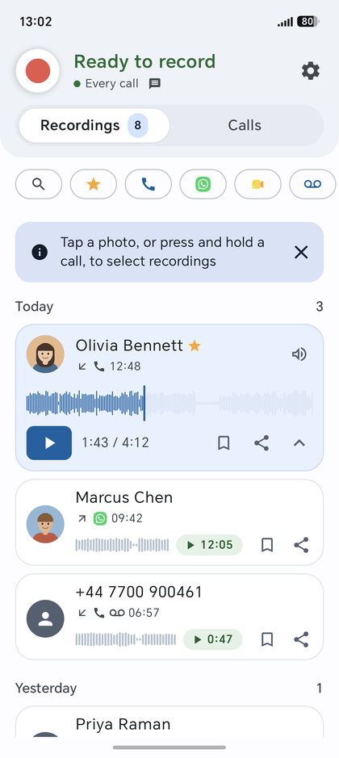
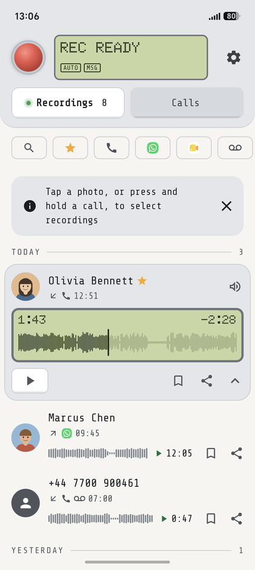
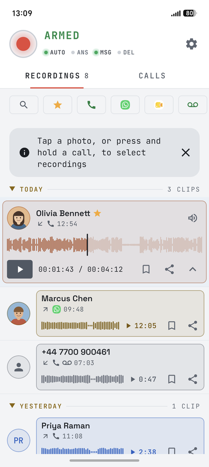
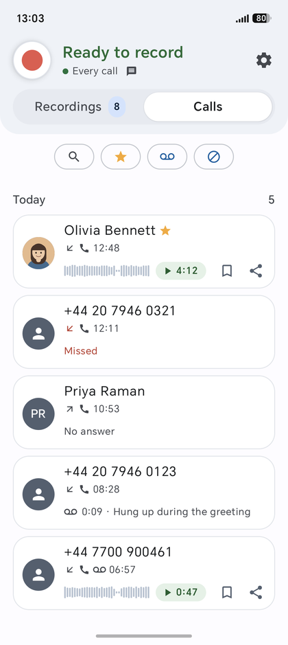
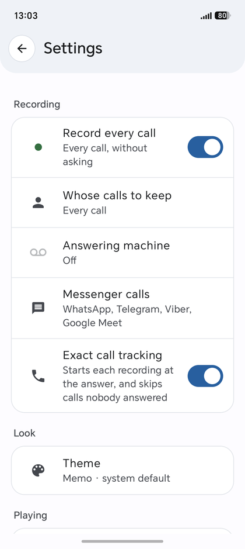
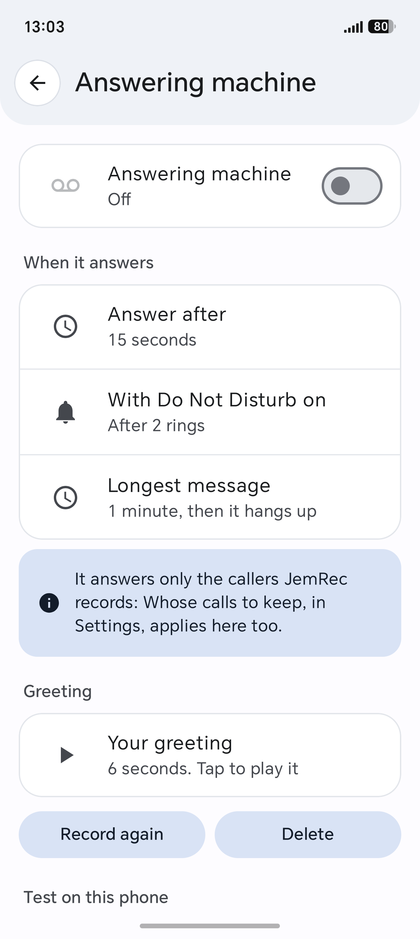
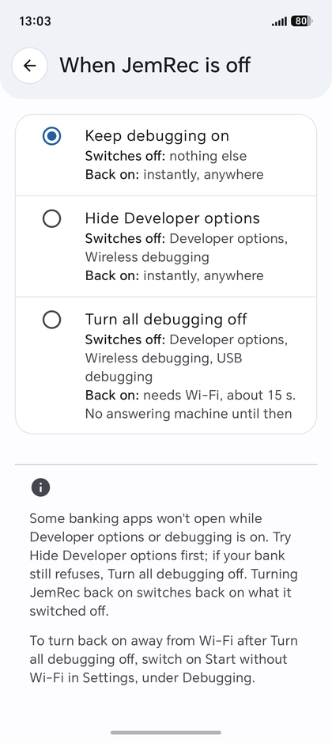
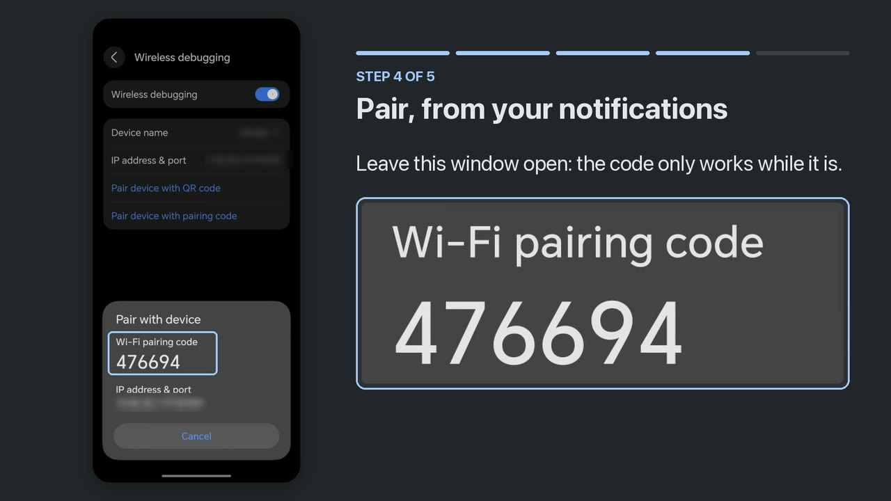
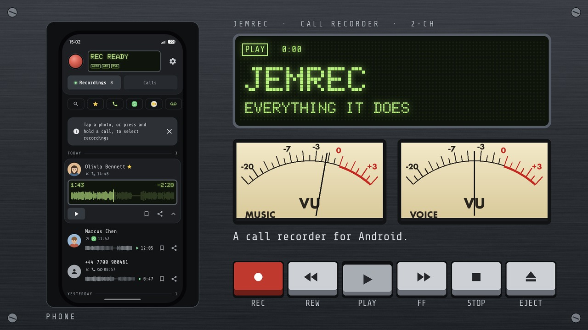
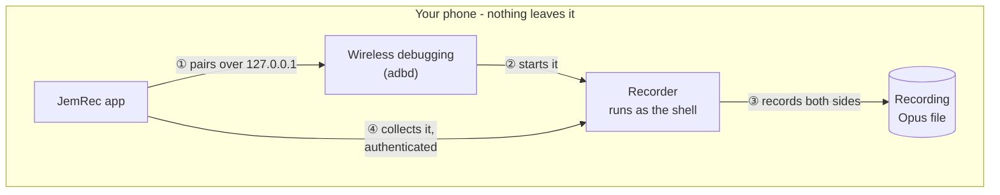

# JemRec

**A call recorder for unrooted Android — phone and messenger calls.**

Both sides of the call. No root, no computer, no second app — 
the phone sets itself up.

[**Website**](https://jemcik.github.io/JemRec/) · [Manual](https://jemcik.github.io/JemRec/setup.html) · [Releases](https://github.com/jemcik/JemRec/releases) · [Privacy policy](https://jemcik.github.io/JemRec/privacy-policy.html) · [Support](#support-jemrec)

[-3DDC84)](#phones-and-android-versions)

<picture><source media="(prefers-color-scheme: dark)" srcset="docs/screenshots/memo/home-dark.png"></picture>
<picture><source media="(prefers-color-scheme: dark)" srcset="docs/screenshots/deck/home-dark.png"></picture>
<picture><source media="(prefers-color-scheme: dark)" srcset="docs/screenshots/multitrack/home-dark.png"></picture>

Three looks - <b>Memo</b>, <b>Deck</b> and <b>Multitrack</b> - each light, dark or as the phone, in Settings → Theme.

<picture><source media="(prefers-color-scheme: dark)" srcset="docs/screenshots/memo/calls-dark.png"></picture>
<picture><source media="(prefers-color-scheme: dark)" srcset="docs/screenshots/memo/settings-dark.png"></picture>
<picture><source media="(prefers-color-scheme: dark)" srcset="docs/screenshots/memo/answering-dark.png"></picture>
<picture><source media="(prefers-color-scheme: dark)" srcset="docs/screenshots/memo/whenoff-dark.png"></picture>

The people in these screenshots do not exist: a screenshot of a call recorder is a screenshot of someone's calls, so the debug build invents them. Everything else is real.

## Why JemRec

- **Both sides of every call.** Phone calls, and WhatsApp, Telegram, Viber and
  Google Meet calls on Android 14 or newer.
- **No root, no computer, no second app.** The phone pairs with its own
  Wireless debugging and sets itself up in a few minutes - once, if you let
  JemRec keep the pairing.
- **Nothing leaves your phone.** No account, no cloud, no analytics. The only
  network JemRec uses is the phone talking to itself.
- **It tells you when something is wrong.** A recording that came out silent,
  a recorder that is down, a call that went by unrecorded - each gets a
  notification, so you do not find out on the day you need the call.
- **Your rules.** Record every call or be asked first, keep only some people's
  calls, and let old or very short recordings clear themselves away.
- **Free, open and verifiable.** Apache-2.0, and F-Droid rebuilds every release
  from this source and checks it matches, byte for byte.

## Get started

1. **Install it** from [F-Droid](https://f-droid.org/packages/com.jemcik.jemrec/),
   or download the APK from [Releases](https://github.com/jemcik/JemRec/releases).
2. **Follow the setup.** JemRec walks you through it and watches for each step:
   two questions (whether to hide Android's debugging notification, and
   whether to keep JemRec paired), Developer options, USB and Wireless
   debugging (no cable needed), and pairing - the phone pairs with itself.
   Type the six-digit code into JemRec's *notification*, not the app: leaving
   Settings closes the code window. Kept paired, that is once: the pairing
   survives restarts; otherwise Android forgets it after 7 days, and JemRec
   asks you to pair again when the recorder next starts. OPPO, OnePlus and realme phones on their
   own systems (ColorOS, OxygenOS, realme UI) need one more switch in
   Developer options, *Disable system optimization* (*Disable permission
   monitoring* on older ones); setup names it.
3. **Let it keep running:** on phones that stop apps in the background
   (Honor, Huawei, Xiaomi, Samsung and others), setup asks you to allow JemRec
   in the phone's own screen for it, and tells you what to tap there. If the
   phone stops JemRec anyway, or holds it back while it restarts the recorder,
   a notification says so. The same screen is in Settings → *Survive a
   restart*.

**Prefer to watch?** The whole setup, start to finish, in 2:22
[on YouTube](https://www.youtube.com/watch?v=rt25pZd8R9M), filmed on an Honor
Magic 8 Pro.

Then run **Settings → Diagnostics → Self-test**. It answers, in about a second,
whether your phone hands over both sides of a call.

The full manual, with what to do when a step misbehaves:
[on the web](https://jemcik.github.io/JemRec/setup.html) or
[in this repository](docs/SETUP.md).

<b>Trouble installing?</b> Play Protect, sideloading, and checking the APK

 

**F-Droid is the easy way:** install the F-Droid client, search for JemRec, and
updates arrive like any other app's. F-Droid is an installer the phone already
trusts once you have allowed it, so nothing below applies.

**The APK from Releases** asks whether to allow installing from your browser or
file manager; that is the sideload prompt. The two are the same file: F-Droid
builds each tag on their own machine, checks the result against the APK here
byte for byte, and publishes **this** project's signed APK rather than one of
their own - so whichever way you installed, the other can update it in place,
with no uninstall and no pairing again. Verified on 0.8: what F-Droid serves is
byte-identical to `jemrec-0.8.apk` on the releases page, down to the signature.

**Play Protect may get in the way, and what it takes differs by phone.** It
warns about apps it has not seen before, which is every app that is not on
Play, so this is not a judgement about JemRec. Three phones, three outcomes:

| Phone | What happened |
| --- | --- |
| Honor Magic 8 Pro | Installed with no complaint. |
| Galaxy S20 | Refused. Turning Play Protect off long enough to install, then back on, worked. It is in the Play Store under your profile picture → Play Protect → Settings. |
| LineageOS | Refused from the browser. Opening the same file from the **Files** app installed it. Each app that can install needs *Install unknown apps* granted to it separately, and not every one of them is allowed to. |

**To check what you downloaded** rather than trust it: every release is signed
with the same certificate, and the release workflow prints its digest on each
run:

    apksigner verify --print-certs jemrec-0.8.apk
    SHA-256: 50aeab3630f0198ea3845db51413b1ad29582f78240fa2df6fe55ba8537afdf8

<b>Why "start by itself" matters</b> after a restart

 

A reboot kills the recorder, and building it again takes a few seconds of
Wi-Fi. With auto-start allowed (on an Honor: Settings → Battery → App launch →
JemRec → *Manage manually*, with *Auto-launch* on), the recorder was back
**ten seconds** after Wi-Fi came on, with the app never opened. Without it,
the phone declined to start the app at boot and nothing came back by itself -
**opening JemRec once** had it recording sixteen seconds later. That is the
fallback, and it always works.

On MagicOS 11 a restart can leave Wireless debugging switched on without
starting it. Since 0.25.1 JemRec sees that and switches it off and on itself:
recording again **eleven seconds** after its first try, which came as the
phone was unlocked, with the app never opened. Since 1.5 Wireless debugging is
off before a restart, unless you had it on, and switching it on starts it: on
the same phone, restarted with it off, the recorder was up 10.4 seconds after
JemRec's Wi-Fi try, about 13 after its first, nothing tapped.

Wi-Fi is needed to *rebuild* the recorder, never to use it. Once it is up,
recording carries on with Wi-Fi off, on mobile data, anywhere. The measurements
are in [How JemRec works](docs/ARCHITECTURE.md#after-a-restart).

Android's own Battery setting for an app can hold JemRec back on any phone.
Set to *Restricted*, Android lets nothing of JemRec's run in the background:
none of its jobs runs there, so a recorder that stops may stay stopped until
something starts JemRec - you opening it, or Android for a reason of its own.
With exact call tracking
off, a call is saved only when you next open JemRec - a messenger call most
likely too, though that is not measured - and in Ask first it is not recorded
at all. Auto-delete and the trash's 30 days wait for it as well.
JemRec says so, on its home screen and once in a notification, with a button
to App info, where it is changed.

> [!IMPORTANT]
> **Recording calls is your responsibility.** Consent law differs by country and
> sometimes by state: one party, all parties, or a spoken notice. JemRec records
> what you tell it to and warns nobody on your behalf.

## What you can do

**Prefer to watch?** What it does, in 1:51
[on YouTube](https://www.youtube.com/watch?v=v5JV6KUUj_I), on the app's own
screens.

| | |
| --- | --- |
| **Record every call, or be asked** | Automatic mode records every call; ask-first records nothing until you tap Record. About 12 MB an hour, or smaller or larger in Settings → Saving → Quality. A Quick Settings tile turns recording on and off, and a long press on it opens JemRec. → [more](docs/ARCHITECTURE.md#recording-and-being-asked) |
| **Start at the answer** | Exact call tracking cuts the ringing, skips calls nobody answered, and splits call waiting into one recording per call. → [more](docs/ARCHITECTURE.md#exact-call-tracking) |
| **Keep only the calls you want** | All your contacts, all but some, only some, or none - and other numbers on their own switch. → [more](docs/ARCHITECTURE.md#whose-calls-to-keep) |
| **Messenger calls** | WhatsApp, Telegram, Viber, and Google Meet calls and meetings, both sides, each switched on separately, with the caller's name from the app's notification. Android 14+. → [more](docs/ARCHITECTURE.md#messenger-calls) |
| **See every call** | The Calls tab is your call log, each call with its recording - or, if there is none, why. Search either list, or narrow it with a tap. → [more](docs/ARCHITECTURE.md#the-calls-tab) |
| **Name files your way** | By date and time, with the caller, with the phone number for a program that sorts them, or the way Honor's Phone app plays them from its call history. → [more](docs/ARCHITECTURE.md#file-names) |
| **Play, keep, clean up** | A call plays as its waveform, to see where people talk, with both sides in both ears - one earbud is enough - and plays on with the screen off, under the phone's media controls; held to your ear, it moves to the earpiece and the screen goes dark, as in a call. A keep mark, a 30-day Recently deleted, and auto-delete for old or very short ones. → [more](docs/ARCHITECTURE.md#playing-in-the-background) |
| **Hear about problems** | A notification after each call, which also says when its recording came out silent, stopped early or is in parts; and one when the recorder is down, a call went unrecorded or was saved away from your folder, or the phone stopped JemRec or held it back in the background. The home screen says so while JemRec's notifications are off, its battery use is Restricted or its folder is out of reach. A call that came out wrong? *Copy a report* in Diagnostics says how it was recorded, for an issue on GitHub. → [more](docs/ARCHITECTURE.md#after-the-call-and-when-something-is-wrong) |
| **Answering machine** | Off until you switch it on. Answers a phone call you have not taken after 5 to 30 seconds - after two rings when Do Not Disturb would silence the caller - plays the greeting you recorded and keeps the message, by the same rules as recording. Take the call or hang up from its notification while they speak. It stands down for a day after you call an emergency number. A test call tells you whether it works on your phone. → [more](docs/ARCHITECTURE.md#the-answering-machine) |
| **Open your banking app** | Some banking apps won't open while Developer options or debugging is on. Turning JemRec off can hide Developer options too, or switch all debugging off; turning it on puts back what it switched off - away from Wi-Fi too, with *Start without Wi-Fi*. Settings → When JemRec is off. → [more](docs/ARCHITECTURE.md#off-and-debugging-with-it) |
| **Three looks** | Memo, calm and simple; Deck, a pocket recorder with an LCD and a REC key; Multitrack, a sound editor with a colour for each caller. Each light, dark or as the phone, in Settings → Theme. → [more](docs/ARCHITECTURE.md#three-looks) |

Recordings are Opus files in the phone's standard `Recordings/JemRec` folder,
where any file manager or music app can open them - or in a folder you choose.

## How it works

Android's `voice-call` audio source carries both sides of a call, but only
system-level identities may read it - and the one an ADB session runs as, the
**shell**, is among them. Getting a shell normally takes a computer, root, or a
helper app like Shizuku. JemRec makes the phone its own computer:

1. **The app pairs with the phone's own Wireless debugging** - the same pairing
   a laptop does, with both ends on the same handset.
2. **For a few seconds, it uses that session to start a small recorder** that
   runs as the shell, then closes it, and the recorder switches Wireless
   debugging off again. The recorder outlives both.
3. **The recorder watches the calls and writes each one to a file** itself, so
   a phone that freezes background apps cannot cut a recording short.
4. **The app collects the finished file** over a socket on which the recorder
   and the app each prove who they are.

Wi-Fi is needed only to start the recorder - after a reboot, say - never to
record. **[The full design, and the measurements behind each decision →](docs/ARCHITECTURE.md)**

## Phones and Android versions

| | Phone calls | Messenger calls |
| --- | :---: | :---: |
| **Android 12 and 13** | ✓ | — Android does not allow it |
| **Android 14 and newer** | ✓ | ✓ WhatsApp, Telegram, Viber, Google Meet |

Google Meet was tested on the Honor: calls both ways and a meeting. Signal
takes the same path as the other messengers and has not been tested yet.
Developer options and Wireless debugging are on every Android phone, though the
menu they live in differs by make; JemRec names the right path for yours.
OPPO, OnePlus and realme phones on their own systems (ColorOS, OxygenOS,
realme UI) need one more switch there, and setup names that too.

**Both sides of the call** have been recorded on five phones, across three very
different Android builds:

| Phone | Build |
| --- | --- |
| Honor Magic 8 Pro (BKQ-N49) | MagicOS 10 and 11, Android 16 and 17 — the phone it was developed on |
| Samsung Galaxy S20 | One UI |
| Samsung Galaxy S23 | One UI, Android 16 and 17 — over Wi-Fi Calling too, which it carries like a messenger call |
| Samsung Galaxy M34 | One UI 8.5, Android 16 — over Wi-Fi Calling too, since 0.24, as its owner reported |
| OnePlus | LineageOS 23 |

Five is not a compatibility list. The one thing nobody can promise for a phone
they have not held is its audio hardware: some hand over both sides of the call,
some one, some silence. The **Self-test** answers it on yours in about a second:
it opens a real capture over the same path a call takes and tells you what came
out of it.

**The answering machine** has been tried on two phones: the Honor, on 2G calls
(its carrier would not register it for VoLTE), and a Galaxy S23 over VoLTE and
Wi-Fi Calling. Whether a phone carries a greeting to the caller is up to its audio
hardware too - Android's own answer was wrong on the
Honor - so the answering machine's settings hold its own checks and a test call.

## Privacy and permissions

- **No microphone permission.** The app never records; the recorder does the
  capturing - calls, and your answering-machine greeting.
- **Nothing leaves the phone**, and nothing is collected about you. *Copy a
  report* in Diagnostics puts how the last call was recorded on the clipboard,
  with no number, name or sound in it, only when you tap it. *Newest version*
  in Settings opens GitHub in your browser when you tap it; JemRec itself asks
  no server anything.
- **Calls and contacts only if you allow them** - to name callers, keep calls
  by who they were with, and notice a call that went unrecorded. Everything
  works without them.
- **No caller on the lock screen.** While a recording plays, the phone's media
  controls name the caller only once it is unlocked; locked, they say *Call
  recording*.
- **USB debugging stays on while JemRec is on**, because the recorder needs
  it; **Wireless debugging only for the seconds JemRec takes to start the
  recorder**, unless you switch it on yourself. While JemRec is off, they can
  go too (Settings → When JemRec is off). While USB debugging is on, a computer
  you have authorised before can connect over a cable; while Wireless debugging
  is on, one you have paired with the phone can connect over the same Wi-Fi;
  an unpaired one cannot. Now and then, check *Wireless debugging →
  Paired devices* and remove anything you do not recognise. With *Keep JemRec
  paired*, which setup asks about, Android forgets no pairing - a computer's
  you allowed over a cable neither - until you turn it off in Settings; Start
  fresh and uninstalling put Android's timeout back - the recorder does it,
  so only while it runs. With *Start
  without Wi-Fi* on, debugging port 5555 is open as well, to every network the
  phone joins, and announced there by the phone's serial number: a computer
  that reaches it, or an app on the phone, can ask to debug the phone, and the
  phone asks you - allow only one you expect.
  → [What stays switched on](docs/ARCHITECTURE.md#what-stays-switched-on)

<b>Every permission, and why</b>

 

In the order F-Droid's listing page shows them, because a permission a call
recorder does not explain is one its user has to guess at:

| Permission | Why |
| --- | --- |
| `INTERNET` | Not about the internet: Android requires it for any TCP socket, including one to `127.0.0.1`. |
| `ACCESS_NETWORK_STATE` | To tell whether there is Wi-Fi to rebuild the recorder over, instead of trying and failing - and for the background checks to ask Android for a network to run with (from Android 14 a job that asks for one needs it). |
| `WRITE_SECURE_SETTINGS` | Granted by the app to itself over its own ADB session. Nothing but a shell can grant it, so no user can be talked into it. It lets JemRec switch Wireless debugging on for each start of the recorder, USB debugging back on when the phone turns it off, and debugging off with JemRec when you ask it to. |
| `POST_NOTIFICATIONS` | The recording notice, the ask-first prompt, the pairing code box. |
| `FOREGROUND_SERVICE`, `FOREGROUND_SERVICE_SPECIAL_USE` | To stay alive while a call is being recorded and while the finished file is collected; while the recorder is restarted after a computer's cable comes out; and for the seconds it takes to warn that the phone stopped JemRec in the background. `SPECIAL_USE` is the honest type: the microphone type would need a microphone permission this app does not hold. |
| `FOREGROUND_SERVICE_MEDIA_PLAYBACK` | To play a recording on with the screen off, under the phone's media controls. It plays; it never records. |
| `RECEIVE_BOOT_COMPLETED` | A reboot kills the recorder; this is what arms the job that rebuilds it. |
| `READ_MEDIA_AUDIO` | To list recordings made before a reinstall. Refusing it only hides those. |
| `READ_EXTERNAL_STORAGE` | Android 12 only, which has no `READ_MEDIA_AUDIO`: the same, to list recordings made before a reinstall. It covers photos and videos too; JemRec reads only its own folder. Refusing it only hides those. |
| `READ_CALL_LOG`, `READ_CONTACTS` | Optional. The only way to know who a call was with: to label a recording, to name a file after the caller or their number, to keep or leave out a call by who it was with, and, for the call log, to notice a call that went unrecorded. |
| `MANAGE_ONGOING_CALLS` | For exact call tracking. Not one an app can ask for: the daemon allows it, as the shell, while the switch is on. Android then tells JemRec when each call is answered and ends. Tracking acts on a call in one case only: it hangs up the answering machine's call if the recorder is lost mid-message. The machine's answering is the recorder's, as the shell. |
| `USE_FULL_SCREEN_INTENT` | Keeps Ask first's question on screen during a call until you answer it; without it, a minute. Given at install; if you turn it off in Android's settings, the question still waits in the shade, and in Ask first home says what it costs. |
| `WAKE_LOCK` | So the keep-alive job can finish its few seconds of work, and so a phone with its screen off stays awake while it brings the recorder back after a USB cable, a minute and a half at most. WorkManager declares it too. And for the lock a phone app holds in a call, which darkens the screen while you hold the phone to your ear to listen to a recording; the proximity sensor it goes by needs no permission, and is read only while JemRec plays a recording on its screen, while a call holds one back, and, once the phone is at your ear, until you take it down. |

What is left out, and why, is in
[How JemRec works](docs/ARCHITECTURE.md#what-it-does-not-ask-for).

## FAQ

<b>Does it really record both sides?</b>

 

Yes, where the phone's audio hardware hands both sides over - which it did on
every phone above. The Self-test tells you for yours in about a second. In a
messenger call each side has a channel of its own, you on the left and the
other person on the right; a phone call has them so where the phone keeps the
two apart, as the Honor does, and on others - a Pixel, by one report - both
channels carry the same mix. On speakerphone, a messenger call's other person
is heard on your side too: your side is the plain microphone, without the call
app's echo cancellation. A call that still comes out with one side - over
Wi-Fi Calling, say - is worth an issue on GitHub: tap *Copy a report* in
Diagnostics right after it and paste that in.

Played in JemRec, both sides are in both ears, so one earbud hears the whole
call; Settings → Playing → *Both sides in both ears* switched off plays each
side in its own ear, as recorded. The file keeps them apart either way.

<b>Does it record Google Meet?</b>

 

Yes, calls and meetings, both sides, on Android 14 or newer - once you switch
Google Meet on under *Messenger calls*. Like the messengers, it is off until
you do. Meet puts its calls through Android's own call service, and up to 0.21
JemRec took them for phone calls and recorded every one, meetings included.
Now a call is a phone call only when Android says the phone itself is in one.

<b>Will callers hear my greeting?</b>

 

On the two phones it has been tried on, yes. No app can play sound into a
call, so the recorder does it as the shell: on the Honor, and on a Galaxy S23
over VoLTE, through an output Android calls *in-call music*; on that S23 over
Wi-Fi Calling through Android's call-screening route, picked for each call by
the way it goes. Not every phone has either. Before you switch the answering machine on,
its *Checks* tell you in a second whether yours does, and a *Test call*
settles it for that kind of call: 2G, VoLTE and Wi-Fi Calling differ. Your
microphone is muted while the greeting plays and the message is left, so the
caller hears your greeting and nothing of your room.

<b>Why does it need Wi-Fi?</b>

 

Only to *start* the recorder: that is the one step that needs Wireless
debugging, which Android runs over Wi-Fi. Once started, the recorder carries on
with Wi-Fi off, on mobile data, anywhere. A reboot stops it, and the next few
seconds of Wi-Fi bring it back by themselves (see
[Get started](#get-started), step 3), once Android gets round to starting
JemRec: five minutes after the unlock on a Galaxy S20 locked again at once.
Unplugging the phone from a computer can stop it too, or on a Galaxy S20
plugging it in (a charger does not); on Wi-Fi it is back within seconds, by
itself. With the screen off, step 3 matters here as well: without it, an
Honor's battery manager kept the recorder down for about four minutes in two
tests of three, and 8.5 minutes in another. Until then nothing is recorded -
the header says so, a notification says the phone held JemRec back the moment
it lets JemRec run again, and one says the recorder is down if it stays down
two minutes (silently during a call, and again with its sound after it).
Ended during a call, the recorder is
started again in the call where it can be, and records the rest of it as a
second recording. And if When JemRec is off is set to *Turn all debugging off*,
turning JemRec back on needs Wi-Fi too.

**Settings → Start without Wi-Fi** takes the Wi-Fi away from all of that
until the phone restarts: it opens debugging port 5555, which the recorder can
be started over with no network at all. After a restart, the first start
needs Wi-Fi once, as before. The cost is the open port, on every network the
phone joins whenever USB debugging is on - unless *Turn all debugging off*
goes with JemRec; see [Starting without
Wi-Fi](docs/ARCHITECTURE.md#starting-without-wi-fi).

<b>Why isn't it on Google Play?</b>

 

Play removed call recorders in 2022 by forbidding the Accessibility API for
recording, and no policy change since has re-opened the door. That is a
distribution decision, not a technical one - the app itself never needed Play,
and F-Droid asks only that a build be free software and reproducible from its
source, which this one is. It never will be on Play.

<b>How do I get a new version before F-Droid has it?</b>

 

From [Releases](https://github.com/jemcik/JemRec/releases), here. F-Droid builds
each release on its own machines and checks it against the APK there before
publishing it, which takes some days: 0.30 reached F-Droid four days after its
release. What it publishes is that same APK, signed by JemRec's own key, so the
one from Releases installs over F-Droid's as an update - nothing lost, no
pairing again - and the next one can come from either.

- **What you have, and what is newest:** Settings → About shows this
  version, and *Newest version* opens the newest release in your browser. Its
  page has the APK; open the download, and allow your browser to install apps
  if Android asks (see *Trouble installing?* above).
- **To be told of each release:** an app that watches GitHub releases, such
  as [Obtainium](https://github.com/ImranR98/Obtainium), installs updates from
  the releases page and notifies you of new ones; or, with a GitHub account,
  *Watch → Custom → Releases* on this repository.

JemRec does not check for updates itself: it would have to reach the internet
and be allowed to install apps, and it does neither.

<b>Is recording calls legal?</b>

 

It depends on where you and the other person are: some places need one party's
consent, some everyone's, some a spoken notice. That is your responsibility;
JemRec records what you tell it to and warns nobody on your behalf.

<b>Where are my recordings, and what happens to them if I uninstall?</b>

 

In the phone's standard `Recordings/JemRec` folder (or the folder you chose),
as Opus files any music app can play; Share can also convert one to `.m4a` for
iPhones and Macs. An hour of calls takes about 12 MB; Settings → Saving →
*Quality* has a smaller choice and two larger ones, for calls recorded from
then on. They are yours rather than the app's, so they stay when
JemRec is uninstalled - delete them first if you want them gone. Deleted ones
wait in Recently deleted for 30 days. Installed again, JemRec shows them as
they were, once you let it read them (it asks): each recording carries its own
marks - a message, kept, who a messenger call was with - inside the file.

<b>Setup says Android would not let JemRec change debugging settings</b>

 

Your phone refuses JemRec the one setting setup grants it until a switch of
the phone's own is set, and the card names it. On an OPPO, OnePlus or realme
phone it is *Disable system optimization*, the last switch in Developer
options' Apps section (*Disable permission monitoring* on older ones; where it
says just *Permission monitoring*, turn that off instead); some show it only
in English, so if it is not there, set the phone's language to English, turn
it on and set the language back. On a Xiaomi it is *USB
debugging (Security settings)*. Then tap **Try again**. Setup does not finish
without that setting: it is what lets JemRec turn Wireless debugging on to
start its recorder, after a restart say. Leave it that way afterwards: the
recorder needs it too, to switch Wireless debugging off again after each
start, and to turn debugging off when JemRec is uninstalled. Reported from two OnePlus phones
(issues #61 and #64); we have none to try it on.

<b>My banking app won't open while debugging is on</b>

 

Choose in Settings → **When JemRec is off** what goes off with JemRec, then
turn JemRec off - with the record button or the Quick Settings tile - before
you open the bank:

- **Hide Developer options**: Developer options go off. USB debugging stays on,
  so JemRec keeps its recorder and turns back on instantly, anywhere.
- **Turn all debugging off**: USB debugging goes off too, and the recorder with
  it. Turning JemRec back on then needs Wi-Fi and takes about 15 seconds, and
  the answering machine is off until then. Away from Wi-Fi, JemRec asks first -
  unless **Start without Wi-Fi** is on (Settings → Debugging): then it comes
  back anywhere, on mobile data or none, until the phone restarts.

Try the first; if your bank still refuses, the second. Wireless debugging is
off already while JemRec runs - JemRec switches it on only for the seconds it
takes to start the recorder - and if you switched it on yourself, either
choice switches it off too. With **Start without
Wi-Fi** on, the first leaves debugging port 5555 open while JemRec is off, which
a bank may look for too; the second closes it. Turning JemRec back on puts back
what it switched off. Measured on an Honor (Android 17): with
Developer options and Wireless debugging off, the recorder ran on through Wi-Fi
off and on, a locked screen and a call, recorded both sides. Our own banks open
with debugging on, so we could not test one that refuses - if yours needed the
second choice, or neither worked, say so in [issue #37](https://github.com/jemcik/JemRec/issues/37).

<b>Why does JemRec ask me to pair again?</b>

 

Android forgets a debugging pairing 7 days after it is made, however often
JemRec connects over Wireless debugging: those connections never renew it.
(Ones made in adb's older way do - over a cable, or to *Start without
Wi-Fi*'s port 5555 - by Android's source; not measured.) The recorder keeps
recording, but the next time it has to start - after a restart, say - the phone
turns JemRec away, and JemRec opens its pairing step and says why. Turn on
*Keep JemRec paired* in Settings (setup asks about it) and Android keeps the
pairing for good: it turns Android's pairing timeout off - *Disable adb
authorization timeout* in Developer options, on phones that show it (an Honor
does not) - which keeps a computer you allowed over a cable as well.
Removed under *Wireless debugging → Paired devices*, a pairing is gone at once
either way. → [Keeping the pairing](docs/ARCHITECTURE.md#keeping-the-pairing)

<b>How do I turn debugging off for good?</b>

 

Uninstall JemRec first. If the recorder is running, it notices the uninstall
within a few minutes, puts back Android's pairing timeout if *Keep JemRec
paired* turned it off, turns both debugging switches off and exits - on an
OPPO, OnePlus or realme phone only while its *Disable system optimization*
switch is set as setup asked, or they stay on for you to turn off. Either way, once JemRec is gone nothing
turns them back on. To have it off only while JemRec is off, see the question
above.

Something else? Ask in [Discussions](https://github.com/jemcik/JemRec/discussions),
where ideas go too. A call that came out wrong is worth
[an issue](https://github.com/jemcik/JemRec/issues/new?template=bug.yml),
with *Copy a report* from Diagnostics, tapped before the next call.

## Support JemRec

JemRec is free: no ads, no account, and nothing collected about you. If it has
been useful to you, you can support its development on
**[Donatello](https://donatello.to/jemcik)**.

## For developers

Build with **JDK 21** (exactly - the daemon's bytes depend on it) and an Android
SDK with platforms 37 and 36 and build-tools 36.0.0:

    ./gradlew assembleDebug     # build
    ./gradlew test              # 2692 tests, screenshots of the screens included

| | |
| --- | --- |
| [How JemRec works](docs/ARCHITECTURE.md) | The design, the measurements behind it, every feature in depth, and every permission. |
| [Developing JemRec](docs/DEVELOPMENT.md) | Building, the tests (logic, screenshots, emulator checks), and how a release reaches F-Droid. |
| [SETUP.md](docs/SETUP.md) | The end-user manual: every step, and what to do when one misbehaves. Generated by `tools/build_site.py` along with [the same page on the site](https://jemcik.github.io/JemRec/setup.html) - edit it there, or the two drift. |
| [ADB-NOTES.md](docs/ADB-NOTES.md) | Four undocumented behaviours of the ADB library, each measured, each of which cost a day. |
| [fastlane/metadata](fastlane/metadata/android/en-US) | The F-Droid listing: description, changelogs, icon and screenshots, written by `tools/render_icon.py` and `tools/shoot.py` alongside the README's. |

Everything else that would have gone in a document is in the code, beside the
thing it explains, with the measurement it came from.

JemRec is written by one person and does not take pull requests. An idea is
welcome in [Ideas](https://github.com/jemcik/JemRec/discussions/categories/ideas).

## Licence

Apache-2.0. See [LICENSE](LICENSE), and [NOTICE.md](NOTICE.md) for what is
vendored and under what terms — chiefly an audio-only fork of
[scrcpy](https://github.com/Genymobile/scrcpy)'s server in `shellserver/`, whose
every modification is listed in [shellserver/PATCHES.md](shellserver/PATCHES.md).
