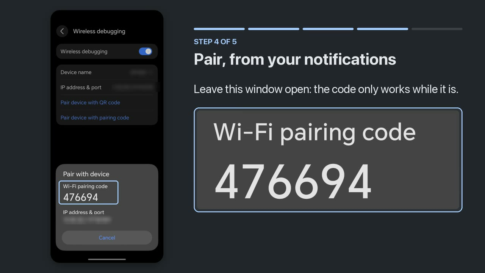

# Setting up JemRec

Everything happens on the phone. You will not need a computer, a cable, or a
second app. It takes about three minutes, and you do it once.

<!-- Generated by tools/build_site.py - edit the SETUP blocks there. -->

**Prefer to watch?** The whole setup, start to finish, in 2:22 [on
YouTube](https://www.youtube.com/watch?v=rt25pZd8R9M), filmed on an Honor Magic
8 Pro.

Every step below was walked through on an Honor Magic 8 Pro running MagicOS 10,
and the screen names are the ones that actually appear there. Other phones
differ in wording; the shape of the process does not, and JemRec names the
right path for your phone as you go.

## Installing

**The easy way is F-Droid**: install the F-Droid client, search for JemRec, and
updates arrive like any other app's. The listing is at
`f-droid.org/packages/com.jemcik.jemrec`. None of the rest of this section
applies — F-Droid is an installer the phone already trusts once you have
allowed it.

**Or download the APK** from the project's **Releases** page and open it.
Android asks whether to allow installing from whatever you opened it with — a
browser, or a file manager — and that permission is granted per app, not once
for the phone.

Either way you get the same file. F-Droid builds each release on their own
machine, checks the result against the APK on the Releases page byte for byte,
and publishes this project's signed APK rather than one of their own — so
whichever way you installed it, the other can update it in place, with no
uninstall and no pairing again.

**Play Protect may object, and what it takes differs by phone.** It warns about
apps it has not seen before, which is every app that is not on Google Play, so
this is not a judgement about JemRec. Three phones, three outcomes:

| Phone | What happened |
|---|---|
| Honor Magic 8 Pro | Installed with no complaint. |
| Samsung Galaxy S20 | Refused. Turning Play Protect off long enough to install, then back on, worked — it is in the Play Store under your profile picture → Play Protect → Settings. |
| OnePlus on LineageOS | Refused when the download was opened from the browser. Opening the same file from the **Files** app installed it. |

If yours refuses, those are the two things to try, in that order: open the file
from a file manager rather than the browser, and only then consider turning
Play Protect off for the minute it takes — and back on afterwards.

Every release is signed with the same key, so each one installs over the one
before it. If you would rather check what you downloaded than trust it,
`apksigner verify --print-certs` on the file should report SHA-256
`50aeab3630f0198ea3845db51413b1ad29582f78240fa2df6fe55ba8537afdf8`, the same
digest the release workflow prints in its log on every run.

## Step 1 — Open JemRec and allow notifications

1. Open **JemRec**.
2. It asks for **notifications**. Allow them.
3. It also offers to read audio files (on Android 12, photos and media: it has
   no choice for audio alone), which lets it list recordings made before a
   reinstall. Refusing that is fine; only the old ones are hidden.

Notifications are not decoration here. They are how the app tells you a call is
being recorded, how it asks whether to record one, and where you will type the
pairing code in step 4.

JemRec does **not** ask for microphone access and does not have it. The
recording is done by a separate, more privileged helper that the app starts
later; the app itself only collects the finished file.

**Then one question.** Before you switch anything on, JemRec says what stays
on: USB debugging and Wireless debugging, for as long as it is installed,
turned back on if they go off. Android shows a notification for as long as
debugging is on, and JemRec asks whether to hide it. Either answer works.
Hidden, nothing on screen reminds you that debugging is on; you can change it
later in Settings.

## Step 2 — Turn on Developer options

Skip this if Developer options are already on.

1. Open **Settings**.
2. Search for `build number`. It usually lives under **About phone**, but the
   path differs between phones, which is why searching beats hunting.
3. Tap **Build number** seven times.
4. Enter your PIN or pattern if asked.

You should see *You are now a developer*.

JemRec moves on by itself once it sees them on. Some phones on Android 17,
Pixels from the September 2026 update among them, no longer tell apps whether
Developer options are on, so JemRec cannot see it. There the card has a **They
are on already** button: tap it once they are.

## Step 3 — Turn on both debugging switches

**Be on Wi-Fi before you start this.** Wireless debugging only stays on while
the phone has a Wi-Fi connection.

1. In JemRec, tap **Open settings**, then search Settings for **Developer
   options**. The app also names the menu it usually lives in on your phone —
   though on a custom ROM such as LineageOS it is under **System**, whoever
   made the handset.
2. Turn on **USB debugging** and **Wireless debugging**. Either order. No cable
   is needed and none should be plugged in.
3. If Android asks whether to allow wireless debugging on this network, tick
   **Always allow** and tap **Allow**.
4. Look at both switches once more. One of them can switch itself off the first
   time; turn it on again and it holds.

**Why both.** Wireless debugging is the channel JemRec uses to start its
recorder. USB debugging — the setting, with no cable involved — is what keeps
Android's debugging service alive, and without it Wireless debugging switches
itself off again before the app can connect.

> If you see an old **JemRec** under *Paired devices*, tap the gear beside it
> and forget it. It is left over from a previous install and cannot be used: a
> reinstalled app has a new key and must pair again.

## Step 4 — Pair, from your notifications

**Read this step before starting it.** The obvious approach does not work, and
knowing why saves repeating it.

The pairing dialog exists only while Settings is on screen. Leave Settings — by
switching to JemRec, or by pressing Back — and Android tears the dialog down
instantly, taking the code with it.

The notification shade is different. It belongs to the system rather than to
another app, so pulling it down leaves Settings running and the dialog intact.
That is where you type the code, and JemRec posts the field before you go
anywhere so it is already waiting.

1. In JemRec, tap **Open settings**.
2. Open **Wireless debugging**, then tap **Pair device with pairing code**. Six
   digits appear.
3. **Swipe down** from the top of the screen, over that dialog.
4. Find **JemRec — pairing** and tap **Enter code**.
5. Type the six digits and send them.

You do not need the port number. JemRec finds that itself.

Then watch that same notification. It says what is happening, and if a
debugging switch turned itself off it says which one — turn it back on and the
app connects by itself. There is no need to pair again or to fetch a new code.

> The code changes every time the dialog is reopened, so always use the one on
> screen. If you swiped the notification away, tap **Show the code field
> again** in JemRec to bring it back.

## Step 5 — Wait a few seconds

JemRec does the rest by itself: it grants itself the one privileged setting it
needs, starts the recorder, and begins watching for calls. When it is done the
header says **Ready to record**.

There is no permanent notification. The app is dormant between calls — the
recorder is a separate process that does the watching — so a notification
appears for the length of a call, and one more when it ends, with the recording
on it.

## Step 6 — Test it

Call someone and talk for twenty seconds, with both of you speaking.

- During the call a notification says **Recording call**.
- When you hang up, a notification shows who the call was with and how long it
  was, with **Play**, **Share** and **Delete**. The recording is also at the
  top of JemRec's list.

Files are named like `20260907_150909_out.ogg` — date, time, and `in` or `out`
for the direction. They are ordinary Ogg Opus files that any player can open.

If your recording has only your own voice on it, that is the one thing no app
can fix: your phone's audio hardware does not hand the other side to apps at
all. **Settings → Diagnostics → Self-test** answers that in about a second,
without ringing anybody.

## Where recordings go

The phone's standard **Recordings/JemRec** folder, which any file manager or
music app can open, and which survives uninstalling the app. To use a different
folder, open Settings and tap **Change** under *Saving to*.

## Choosing when to record

**Record every call**, in Settings, decides this.

- **On**, the default: every call is recorded and you are not asked.
- **Off**: when a call starts a notification appears with **Record** and **Not
  now**. Nothing is captured until you tap Record, so the opening seconds of
  that call are not saved. That is the honest cost of being asked, and it is
  why the switch is on by default.

The prompt stays up for about a minute rather than the few seconds an ordinary
notification gets, and if you miss it, it waits in the shade for the rest of
the call. On a locked screen you get the same question full screen.

## Exact call tracking

**Exact call tracking**, in Settings, is on unless you turn it off. With it,
Android tells JemRec when each phone call is answered and when it ends, and so:

- A recording starts when the call is answered. An outgoing call's ringing is
  not in it, and a call nobody answered is not saved at all.
- With call waiting, each call gets its own recording.
- Whose calls to keep decides before anything is recorded.

Tracking only reads this: it never answers, holds or ends a call, and shows no
screen of its own during one. The one thing that ever answers a call is the
answering machine, below, when you switch it on. Turned off, JemRec records
from the moment the phone goes off-hook, as it did before 0.14, and the
answering machine, which needs it, answers nothing.

## Whose calls to keep

**Whose calls to keep**, in Settings, narrows down which calls are kept. **Your
contacts**: all of them, all but some, only some, or none — for the last three
you pick the contacts. **Other numbers**, a switch of its own: numbers not in
your contacts, and hidden ones. Until you change either, every call is kept.

With exact call tracking, JemRec knows who a call is with while it still rings,
and a call your choice leaves out is not recorded at all. Without it, who a
call was with is only known once it has ended, from the call log: every call is
recorded, and one your choice leaves out is deleted the moment it ends, before
it is saved anywhere. Either way, if JemRec cannot tell who it was, the
recording is kept. In ask-first mode, a call you tap Record on is always kept.
The Calls tab marks a call that was left out.

It needs permission to read the call log and your contacts, to tell who a call
was with; its screen asks for it if you have not given it.

## File names

**File names**, in Settings, decides what a new recording is called. Recordings
you already have keep their names.

- **Date and time**, the default: `20261020_165705_out.ogg` — when the call
  began, and which way it went.
- **With the caller**: `20261020_165705_out_Priya Raman.ogg` — easier to find
  in a file manager or on a computer.
- **For Honor's Phone app**, on a phone that has it: `Priya
  Raman@+447700900123_20261020165705.ogg`, the name Honor's own recorder uses.
  Saved in `Sounds/CallRecord` — the File names dialog has a button that opens
  the folder picker right there; tap **Use this folder** and **Allow** —
  Honor's Phone app then shows a play button on the call in its history.

The caller comes from exact call tracking or the call log, with permission to
read the call log; without it, a recording is named by date and time. Google's
Phone app has nothing like Honor's: it keeps its own recordings to itself, and
no other app can add one to its call history.

## Messenger calls

**Messenger calls**, in Settings, records WhatsApp, Telegram, Signal and Viber
calls too — both sides, the other person on the left channel and you on the
right. Each app has its own switch, and all are off until you turn one on. The
ones installed on your phone are listed.

It needs **Android 14 or newer**. Before it, Android does not let the recorder
copy another app's call audio, and Settings says so instead of offering
switches that would record nothing.

An app can refuse to let its calls be recorded, and Android honours that;
JemRec does not try to get round it. Your side comes from the microphone
without the call app's echo cancellation, so on speakerphone the other person
is heard on your side as well. JemRec never takes the microphone from the call:
if Android ever silences the app's own, JemRec lets go of its own at once.

These calls are not in the phone's call log, so their recordings are in
Recordings, marked with the app's icon, and not in the Calls tab. Whose calls
to keep does not apply to them — the app's switch is the rule.

**Show who called** reads the caller's name, and whether the call rang first,
from the app's own call notification — the only place it is said. That needs
notification access, which Android grants to all notifications; JemRec keeps
only that from the call notifications of the apps you switched on. It is
granted over JemRec's own ADB session, so turning it on needs Wi-Fi, once.

Tested on an Honor with Viber, Telegram and WhatsApp, both directions. Signal
takes the same path and has not been tested yet.

## The answering machine

**Answering machine**, in Settings, answers the phone calls you do not take,
plays a greeting you recorded, and keeps what the caller says as a recording.
Phone calls only: not WhatsApp, Telegram or Viber calls. It is off until you
turn it on, and it needs two things first: your greeting, and the checks under
*Test on this phone*.

**Your greeting.** Tap **Record**, say it, and tap **Stop** — 30 seconds at
most. JemRec trims the silence at both ends and evens the level, because the
caller hears it at full volume. Tap the row to hear it; **Record again**
replaces it. Callers hear what you said and then a beep, nothing else.

**When it answers**

- **Answer after** — 5 to 30 seconds of ringing. Your carrier's own voicemail,
  if you have it, takes calls after its own timer, so this has to be shorter;
  once you have asked your carrier (below), the row says if its voicemail would
  answer first.
- **With Do Not Disturb on** — after two rings, about 5 seconds, for callers Do
  Not Disturb would silence. Callers it lets through ring as usual.
- **Answer on** — with two SIMs, which one: your default for calls, or both.
- **Longest message** — how long a caller can speak after the beep: 30 seconds,
  1 minute or 2 minutes. Then JemRec hangs up, and the message is saved. Or
  **No limit**, which asks first: the call then lasts until the caller hangs up
  or has been silent for 30 seconds, and your phone is in it until then - a
  caller somewhere noisy may never count as silent.

**Who it answers** is not a setting of its own: it answers only the callers
JemRec records, so **Whose calls to keep** applies to both. It never answers
while you are on another call - a phone call, a messenger call or a meeting -
while roaming, or while recording is off, and a caller JemRec cannot identify
is left to ring. It needs Exact call tracking: turning tracking off with the
machine on asks first, then turns both off.

**After you call an emergency number** it stands down for a day, so an
emergency service calling you back - from any number - rings until you can pick
up; a call the network marks as their callback is never answered. The switch
says until when, and **Answer again now** ends the pause early, after a
warning. iPhone does the same with its call screening, for 24 hours.

**While it takes a message**, your microphone is muted: the caller hears your
greeting, the beep, and nothing of the room you are in. A notification,
**Taking a message**, has **Talk to them** — the greeting stops, your
microphone opens and the call is yours — and **Hang up**. Unmuting on the call
screen takes the call too, and so does answering a second call, one waiting or
one you place. A call you take is saved as an ordinary recording, not a
message, from just before you took it - or from the caller's first words, if
they spoke first. In **Ask first** it is not: taking the call ends the message
there - what the caller said is kept as the message - and you are asked, as at
the start of any call, whether to record the rest. Answering machines have
always stopped recording when picked up.

**The message** is saved like any recording, from just before the caller starts
speaking, so it does not begin with them listening to your greeting. It has a
message icon, the **Messages** chip above the list shows only messages, and a
notification with a sound says who left it. Auto-delete for short calls never
removes one. A caller who hangs up during the greeting without a word leaves
nothing; the Calls tab says **Hung up during the greeting**.

**Test on this phone.** No app can play sound into a call, so the recorder does
it, as the shell, and whether a phone carries it to the caller depends on its
audio hardware. These tell you:

- **Checks** — a second, and no call: whether the recorder has what it needs
  and the phone has a way to play into a call. The switch can be turned on once
  they pass.
- **Test call** — best, someone calls you: the next call within three minutes
  is answered with a short tone and your greeting, whoever is calling, and then
  you are asked whether they heard it - not in the day after an emergency call,
  when that caller may be them. Or JemRec calls a number that answers by
  itself, such as your carrier's information line, and measures what it can;
  never an emergency number. 2G, VoLTE and Wi-Fi Calling are kept apart,
  because each takes its own path.
- **Carrier voicemail** — asks your carrier when its voicemail answers, and can
  make it wait the longest it allows, 30 seconds. Your carrier's voicemail then
  still takes the calls JemRec does not. It is your carrier's setting, so it
  stays if JemRec goes.
- **Copy a report** — this phone and what the tests found, with nothing about
  any call, to paste into a report on GitHub.

Experimental. Tested on an Honor, on 2G calls; its carrier would not register
it for VoLTE. On a phone not tried yet, the test call is how to know.

## Playing, sharing and deleting

Recordings are listed newest first, under **Today**, **Yesterday** and
**Earlier**. Tap a recording to play it inside the app. Its waveform appears
under the row - tall where someone is talking, flat where it is quiet - and a
tap or a drag on it goes to that place. A call's waveform is worked out as it
is saved, and an older recording's while the app is open; one played before
then has a plain slider for a moment - about two and a half seconds for a
30-minute call. The chevron beside it folds the player away. The share button
offers the original file or a converted copy that plays anywhere.

**With the screen off.** A recording plays on when the screen goes off or you
leave the app, under the phone's own media controls: in the notifications, in
Quick Settings, on the lock screen, and on an Honor in the pill at the top of
the screen. They name the caller only once the phone is unlocked; locked, they
say **Call recording**. A call ringing in pauses it, and it plays on after;
headphones coming out pause it until you play it again. It does not start
during a call. The notification's pause, or the chevron, stops it; swiping
JemRec away leaves it playing, as music apps do.

**Finding a recording.** The chips above the list narrow it: favourites, the
phone or a messenger, kept, messages. The magnifier opens a search by name,
number or time. Chips of one kind add up - WhatsApp and Telegram - and
different kinds narrow: and favourites. A chip only appears where it would
narrow the list, and one that is on stays, so you can turn it off. While
anything narrows the list, a line under the chips says what, and how many of
how many are shown; **Show all** brings everything back.

To delete, tap a contact's photo or long-press a row to start selecting, tick
what you want, and use the bin in the toolbar. It asks first and tells you how
many.

**Deleting is not immediate.** A deleted recording goes to **Recently
deleted**, in Settings, waits there 30 days, and can be restored until then.
After that it is gone for good. In the standard Recordings folder this is
Android's own trash, so other apps stop seeing the file at once.

**Keep what matters.** The bookmark on each row marks a recording to keep:
auto-delete never touches it, and the bookmark chip above the list shows only
kept recordings. To mark several, select them and use the bookmark in the
toolbar.

The notification after each call has the same three buttons. Play and Share
open JemRec at that recording; Delete asks first, in the notification itself,
and **Keep** puts it back.

If a recording was made before JemRec was reinstalled, Android asks before
JemRec may move it to the trash, in a dialog of its own. That is Android
checking who owns the file, not JemRec asking twice.

Recordings are kept when JemRec is uninstalled, because they are yours rather
than the app's — so if you want them gone, delete them **before** you
uninstall. Recently deleted ones in the standard folder are still emptied by
Android on time. In a folder you chose, they stay behind as hidden files,
because removing them is JemRec's job.

Installed again, JemRec shows your recordings as they were, once you allow it
to read them: which are messages, which you kept, and who each messenger call
was with are written inside each recording, not only in the app. A folder you
chose has to be chosen again, and until then its recordings are not listed.

## The Calls tab

The **Calls** tab, beside Recordings, is your phone's call log, under the same
day headings. A call that was recorded has the ▶ beside its length and plays on
a tap; one the answering machine took says **Message**. A call that was not
says why, where JemRec knows: **In Recently deleted**, **Recording deleted**,
**Left out by your rules**, **Too short**, **Recorded, not saved yet** (still
on the recorder, collected when it can be), **Recording was off**, **Ask first,
not recorded**, **Hung up during the greeting**, **Answering machine test**.
**Not recorded**, in red, means recording was on and automatic and nothing was
saved — run the self-test. **Greeting could not play**, in red too, means the
answering machine answered and hung up without taking a message - the greeting
would not play, or your microphone would not mute — run its test call. JemRec
remembers deleted and left-out calls for a week, so it says this only for the
last week. **No recording** is an older call, or one from before JemRec kept
track, with no guess at why. Missed, declined and blocked calls are marked as
such.

Its chips work as the Recordings tab's, with **Not recorded** for the calls
that connected and were not recorded; its search finds a name or a number. When
nothing matches, it says so.

It needs permission to read the call log, the same optional permission that
puts names on recordings; the tab asks for it if you have not given it.

## Three looks

**Settings → Theme** changes how JemRec looks, never what it does. **Memo**,
the default, is calm and simple, with one big record button; **Deck** is a
pocket recorder, with a REC key and an LCD; **Multitrack** is a sound editor,
each caller in a colour of their own. Under them, **Light**, **Dark** or
**System**, as the phone is set. The preview at the top shows the look you
pick, with invented calls, and the app changes at once. Notifications and the
Quick Settings tile always follow the phone.

The header holds the same things in every look: the record button, which turns
recording on and off; whether JemRec can record right now, and if not, what to
do; a line of what is on - in Memo in words and icons, on Deck's LCD as
**AUTO** or **ASK**, **ANS**, **MSG** and **DEL** with the age, in Multitrack
as a row of LEDs, lit for what is on; the gear for Settings; and the
**Recordings** and **Calls** tabs, Recordings with how many there are. The
settings the header marks wear the same mark in Settings. With the phone on its
side, the header becomes a panel at the left - the chips and search in it, with
their names, the tabs at its foot - and the list beside it takes the full
height.

## Turning JemRec off

The record button in the header - Memo's round button, Deck's REC key,
Multitrack's armed button - is the on/off control for the whole app. Off means
no call is recorded and no notification appears. Your recordings and your
pairing are untouched, and the recorder itself keeps running in the background
doing nothing — which is what makes turning it back on instant, anywhere, with
no network.

The same switch is a **Quick Settings tile**, so you can flip it without
opening the app. Settings has a row that adds it, on Android 13 and later; on
12, edit the Quick Settings panel and drag JemRec in. On a locked phone the
tile asks for your unlock first.

## After a restart

A reboot kills the recorder, and building it again takes a few seconds of Wi-
Fi. Until that has happened, calls are not recorded and the header says so —
and if it lasts more than two minutes, a notification does too. Whether it
happens without you comes down to one setting on your phone.

### Allow JemRec to start automatically

This is the fix, and it is worth doing once. JemRec's own Settings has a
**Survive a restart** row that opens the right screen on your phone, because
the list is four levels deep and called something different on every make. On
an Honor it is *Settings → Battery → App launch*; find JemRec, switch it to
**Manage manually** and leave **Auto-launch** on. Xiaomi calls it Autostart,
OPPO and vivo have their own. The row only appears on a phone that has such a
list.

What it buys, measured on that Honor: the app was started by the boot broadcast
at 21 seconds of uptime, armed its scheduled job and asked the system to wake
it when Wi-Fi appeared, and the recorder was back **ten seconds** after Wi-Fi
came on — with the app never opened.

### Without it, open JemRec once

The same phone with auto-launch off does nothing at all. The system declined to
start the app for the boot broadcast — *don't meet cpuload*, in its own log —
so neither the job nor the Wi-Fi watcher was ever armed, and seven minutes
after Wi-Fi returned nothing had come back. Opening the app had it recording
sixteen seconds later.

So if you would rather not touch battery settings, treat opening JemRec once as
part of restarting the phone. It always works.

Either way: Wi-Fi is needed to rebuild the recorder, never to use it. Once it
is up, calls are recorded with Wi-Fi off, on mobile data, anywhere.

## What the app tells you

The header is the honest indicator:

| It says | Meaning |
|---|---|
| **Ready to record** | A call would be recorded right now. |
| **Recording call** | In the notification, during a call. |
| **Cannot record, needs Wi-Fi** | Join any Wi-Fi and it resumes on its own. Usually a reboot, or a long stretch away from a network. |
| **Cannot record, tap to start it again** | On Wi-Fi, the recorder did not come back. Tap the line to try now. |
| **Cannot record, tap to allow this Wi-Fi** | You are on a Wi-Fi network Android has not allowed Wireless debugging on. Tap the line, tick **Always allow on this network** and tap **Allow**. |
| **Cannot record, tap to pair again** | Wireless debugging turns JemRec away, as it does once its pairing is deleted. JemRec goes to the pairing step by itself as soon as the home screen shows; the line is there for the moment before. |
| **Starting…** | Rebuilding the recorder. A few seconds. |
| **Off** | You turned the switch off. |

And when the app is closed, in notifications:

| It says | Meaning |
|---|---|
| The caller's name, **Recorded** | After every recorded call, silently, with Play, Share and Delete. Can be switched off in Settings. |
| **Last call recorded, but silent** | The file has the right length and no sound in it. Usually Wi-Fi calling, or a phone that does not hand calls over at all. Run the self-test. |
| **JemRec is not recording calls** | The recorder has been down for two minutes. The notification says why: it needs a few seconds of Wi-Fi, or this Wi-Fi is not allowed for Wireless debugging (with **Allow this Wi-Fi**), or it cannot connect (with **Pair again**), or it could not start. It goes away by itself when the recorder is back. |
| **A call was not recorded** | An answered call in your call log has no recording. Only in Record every call mode, and only with call log access. Run the self-test. |
| **Call not recorded** | A call was recorded but could not be saved, or no call audio came through - or the answering machine answered and could not play your greeting, so it hung up. The notification says which; for the greeting, run the answering machine's test call. |
| **Taking a message** | The answering machine has a caller. **Talk to them** takes the call; **Hang up** ends it. |
| **Message from** the caller | A message, with a sound, Play, Share and Delete. It stays until you dismiss it, whether or not each call is shown when it ends. |
| The caller, with pause and a seek bar | A recording you played, going on with the screen off. On the lock screen it says only **Call recording**. It goes when the recording is stopped. |

## Settings

One screen, in five groups, each row showing what it is set to now, and the
settings the header marks wearing the same mark. Until you allow it, a **Show
who called** card sits at the top: it labels each recording with the contact's
name and photo, or the number when they are not in your contacts, and lets
JemRec tell you if a call went by unrecorded. It needs your call log and
contacts, and is asked for in the app rather than at install. Say no and
everything still works, with the time as each recording's headline.

**Recording**

- **Record every call** — record everything, or be asked each time.
- **Whose calls to keep** — your contacts (all, all but some, only some, or
  none) and numbers not in your contacts. Needs Show who called.
- **Answering machine** — off until you turn it on; see The answering machine.
- **Messenger calls** — a switch for each supported messenger installed, and
  whether to show who called from their call notifications.
- **Exact call tracking** — recordings start at the answer, and calls nobody
  answered are not kept. The answering machine needs it: with the machine on,
  turning it off asks whether to turn both off.

**Look**

- **Theme** — Memo, Deck or Multitrack, and light, dark or as the phone; see
  Three looks.

**Saving**

- **Saving to** — which folder recordings go in, and back to the default.
- **File names** — date and time, with the caller, or the name Honor's Phone
  app plays from its call history.
- **Auto-delete old recordings** and **Auto-delete short calls** — off until
  you choose. Recordings older than 30 days, 90 days, 6 months or a year; calls
  shorter than 5, 10 or 30 seconds. Kept recordings are never touched, and
  whatever is removed waits in Recently deleted.
- **Recently deleted** — what has been deleted in the last 30 days, with
  **Restore** for each, **Restore all**, and **Delete all for good**, which
  asks first: it cannot be undone.

**Notifications and shortcuts**

- **Show each call when it ends** — the silent notification after every
  recorded call. Off hides it; a recording that came out silent is reported
  either way.
- **Quick Settings tile** — adds the on/off tile to the Quick Settings panel.
- **Hide the debugging notification** — the answer to the question in step 1,
  changeable. Debugging stays on either way; this is only about whether
  Android's notification saying so is shown. Turning it on after setup needs
  Wi-Fi.

**Troubleshooting**

- **Survive a restart** — on phones that have one, opens the list of apps
  allowed to start by themselves after a reboot.
- **Diagnostics** — whether the recorder is running, a self-test that proves a
  call would be recorded, and a way to start the recorder by hand. It is what a
  bug report wants.
- **Start fresh** — puts JemRec back to how it was the day you installed it, so
  setup runs again from step 1. The app closes when you confirm. **Your
  recordings are not deleted.**

## If something goes wrong

**Pairing fails every time.** Almost always the dialog closed. It survives only
while Settings is on screen, which is why step 4 uses the notification shade
rather than switching back to the app. Reopen the dialog for a fresh code each
attempt.

**A debugging switch keeps turning itself off.** Some phones do that the first
time one is enabled without a cable, and Android turns Wireless debugging off
whenever Wi-Fi drops. Turn it on again with Wi-Fi connected; it holds the
second time.

**It says it cannot record.** Off Wi-Fi, join any Wi-Fi and leave it a few
seconds; the app rebuilds its recorder without being asked. On Wi-Fi, the
header's line says what to do: tap it to start the recorder again, or to allow
this Wi-Fi.

**Android asks to allow wireless debugging on this network.** That is JemRec
restarting the recorder after a reboot, on a Wi-Fi network you have not used it
on before. Tick **Always allow on this network** and tap **Allow**: Android
lets Wireless debugging work only on networks you allowed, and JemRec needs it
for a few seconds. If you tapped Cancel, the notification and the app's header
offer to ask again.

**Recordings have only your voice.** Your phone's audio hardware does not
expose the other side to apps. Nothing in any app can change that, and the
self-test will tell you plainly.

**JemRec is back on its pairing step, or a notification says it cannot
connect.** The phone has most likely forgotten its pairing — Wireless debugging
→ Paired devices no longer lists JemRec, as after deleting it there. Once
Wireless debugging has turned JemRec away twice in a row, the home screen gives
way to the pairing step, and the notification's **Pair again** opens it too: a
fresh code puts everything back, recordings and settings included. If the
pairing was fine after all, JemRec reconnects without asking for a code.

**A notification says a call was not recorded.** Tap **Self-test**. It says
whether the recorder is running and hearing calls; a recorder that was down at
the time is the usual answer.

## Uninstalling

Uninstall it however you like — long-press the icon, or Settings → Apps. There
is nothing special to do.

The recorder is a separate system process rather than part of the app, so
removing the package does not stop it immediately. It checks every few minutes
whether JemRec is still installed, and when it is not it turns both debugging
switches off, deletes its own files and exits. A reinstall is never fooled by
one that has not got there yet, either: the app only trusts a recorder it
started itself, and retires any other on sight.

> **What no app can undo.** The phone goes on trusting the key it paired with,
> in a list only root can edit, so it stays under *Wireless debugging → Paired
> devices*; remove it there with the gear beside it. Developer options stays on
> if you turned it on. And Start fresh leaves the one privileged setting
> granted, because handing it back would kill the app halfway through the
> reset. If you tapped **Wait 30 seconds** under *Carrier voicemail*, your
> carrier still waits 30 seconds before its voicemail answers: that timer is
> your carrier's, not the phone's, and JemRec did not keep what it was before.
> Ask your carrier to set it back if you want the shorter wait.

## Two honest warnings

**The other person is being recorded too.** Whether you may do that without
telling them differs by country and sometimes by region. That is your call to
make, not the app's.

**This uses debugging switches, and they stay on.** They are developer features
that let software on your phone act with elevated privileges. JemRec needs them
to record calls at all, so it keeps them on, and turns them back on if they go
off. While they are on, a computer that has been paired with this phone can
connect to it on the same Wi-Fi, and one you have allowed before can connect
over a cable — so check *Wireless debugging → Paired devices* now and then and
remove any you do not recognise. If you stop using JemRec, uninstall it first,
then turn Wireless debugging, USB debugging and Developer options back off.
